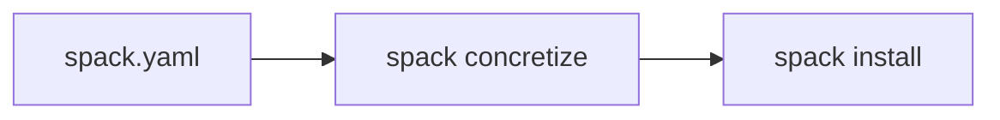
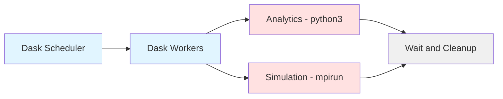

---
# You can also start simply with 'default'
theme: seriph
colorSchema: auto
# random image from a curated Unsplash collection by Anthony
# like them? see https://unsplash.com/collections/94734566/slidev
# background: https://cdn.jsdelivr.net/gh/slidevjs/slidev-covers@main/static/tZr3_JuURZA.webp
background: https://images.pexels.com/photos/11047223/pexels-photo-11047223.jpeg?cs=srgb&dl=pexels-vlad-samoylik-173187996-11047223.jpg&fm=jpg&w=1920&h=1282
# some information about your slides (markdown enabled)
title: Spack Tutorial for Beginners and Advanced Users
info: |
  ## Slidev Starter Template
  Presentation slides for developers.

  Learn more at [Sli.dev](https://sli.dev)
# apply unocss classes to the current slide
class: text-center
# https://sli.dev/features/drawing
drawings:
  persist: false
# slide transition: https://sli.dev/guide/animations.html#slide-transitions
transition: slide-left
# enable MDC Syntax: https://sli.dev/features/mdc
mdc: false
# open graph
# seoMeta:
#  ogImage: https://cover.sli.dev
fonts:
  mono: iosevka-normal Web
  local: iosevka-normal Web
favicon: https://numpex-pc5.gitlabpages.inria.fr/tutorials/images/favicon.png

hideInToc: true
---

<div class="flex flex-row items-center justify-center gap-12">
  
  <div class="flex flex-col items-start">
    <h1 class="font-black text-left">Spack Tutorial for Beginners and Advanced Users</h1>
    <h3><a href="https://numpex.org/">NumPEx</a> <a href="https://numpex.org/exadi-development-and-integration/">Exa-DI WP3</a></h3>
    <h4>Thomas Bouvier</h4>
  </div>
</div>


---
src: ./slides/intro.md
---

---
hideInToc: true
layout: center
---

# Hands-on tutorial

- SSH into a computer center -- we use Grid'5000 in this tutorial.
- Install Spack, discover some of its commands.
- Install the Kokkos library.
- Install and run a Gysela mini-app relying on Kokkos and DDC, and run it (optionally with GPU support).
- Time for questions and discussion.


---

## The mental model

These are some of the key insights to understand how Spack works:

- 📦 Install Spack by cloning the [repo](https:://github.com/spack/spack). Multiple installations allowed.
- ✅ Activate Spack to run commands.
- 📌 Available package versions depend on your Spack clone.
- 🤝 Integrate system packages with "externals".
- 🌍 Write a list of "package specs" to be installed in your Spack environment.
- 🎛️ Package specs allow to pass options like <code class="color-blue">+cuda</code>.

---

## Running example: Kokkos → a Gysela app on Grid'5000


```
 % ssh lille.g5k
```

Connection guide: https://www.grid5000.fr/w/Getting_Started#Recommended_tips_and_tricks_for_an_efficient_use_of_Grid.275000

```ssh-config
# ~/.ssh/config
Host g5k
  User login
  Hostname access.grid5000.fr
  ForwardAgent no
Host *.g5k
  User login
  ProxyCommand ssh g5k -W "$(basename %h .g5k):%p"
  ForwardAgent no
```


---

## Installing Spack core

To install Spack, make sure you have Python & Git. Then, we must clone the repo on the Grid'5000 frontend:

```ansi
# ==> Clone Spack
 % git clone -b releases/v1.2 --single-branch --depth=100 https://github.com/spack/spack.git ~/spack

# ==> Activate Spack
 % . spack/share/spack/setup-env.sh
# For Fish Shell: source spack/share/spack/setup-env.fish

 % spack --version
1.2.2 (3e19345b6e12f5ff1b874f4059622fc6a1fd804a)
```

Spack core is installed in `~/spack`.


---

## Package recipes repository

Spack recipes are separate from Spack core.

```
 % spack config blame repos
```

The default config is as follows:

```yaml
---                                            repos:
~/spack/etc/spack/defaults/base/repos.yaml:14    builtin:
~/spack/etc/spack/defaults/base/repos.yaml:15      git: https://github.com/spack/spack-packages.git
~/spack/etc/spack/defaults/base/repos.yaml:16      branch: releases/v2026.06
```

When executing the first command that needs recipes (`spack list`, `spack install`, ...), Spack clones that repository into `~/.spack/package_repos/<url-hash>/`


```
 % spack cd --repo builtin
```


---

## Compilers

```
 % spack compiler list
==> Available compilers
-- gcc debian13-x86_64 ------------------------------------------
[e]  gcc@13.2.0  [e]  gcc@10.2.1
```

The [e] flag means the compiler was detected as external: these packages do not come from the recipes repository

Let's remove the most recent compiler for now:

```
 % spack compiler remove gcc@13.2.0
==> The following compilers have been removed:

    gcc@=13.2.0
```


---

## Finding a package

Web interface: https://packages.spack.io

```ansi
 % spack list kokkos
hpx-kokkos  kokkos  kokkos-fft  kokkos-kernels  kokkos-nvcc-wrapper  kokkos-tools  py-pennylane-lightning-kokkos  py-pykokkos-base
==> 8 packages

 % spack info kokkos
CMakePackage:   kokkos

Description:
    Kokkos implements a programming model in C++ for writing performance
    portable applications targeting all major HPC platforms.

Homepage: https://github.com/kokkos/kokkos
```

You can also use `spack list 'py-*'`.

---


## Package specs

```ansi{1,2}
 % spack spec kokkos               
 -   kokkos@4.7.04~aggressive_vectorization~atomics_bypass~cmake_lang~compiler_warnings+complex_align~cuda~debug~debug_bounds_check+debug_dualview_modify_check~deprecated_code~hip_relocatable_device_code~hpx~hpx_async_dispatch~hwloc~ipo~memkind~numactl~openmp~openmptarget~pic~rocm+serial+shared~sycl~tests~threads~tuning~wrapper build_system=cmake build_type=Release cxxstd=17 generator=make intel_gpu_arch=none platform=linux os=debian13 target=nehalem %cxx=gcc@10.2.1
 -       ^cmake@3.31.11~doc+ncurses+ownlibs~qtgui build_system=generic build_type=Release platform=linux os=debian13 target=nehalem %c,cxx=gcc@10.2.1
 -           ^curl@8.20.0~gssapi~ldap~libidn2~librtmp~libssh~libssh2+nghttp2 build_system=autotools libs:=shared,static tls:=openssl platform=linux os=debian13 target=nehalem %c,cxx=gcc@10.2.1
 -               ^nghttp2@1.67.1 build_system=autotools platform=linux os=debian13 target=nehalem %c,cxx=gcc@10.2.1
 -                   ^diffutils@3.12 build_system=autotools platform=linux os=debian13 target=nehalem %c=gcc@10.2.1
 -                       ^libiconv@1.18 build_system=autotools libs:=shared,static platform=linux os=debian13 target=nehalem %c=gcc@10.2.1
 -               ^openssl@3.6.1~docs+shared build_system=generic certs=mozilla platform=linux os=debian13 target=nehalem %c,cxx=gcc@10.2.1
...
```

Instead of package names, Spack uses **package specs**: a concrete spec is like a name, but it has a version, compiler, architecture, and build options associated with it.

<code>
kokkos <span class="color-cyan">@4.7.04</span> <span class="color-blue">~aggressive_vectorization ~atomics_bypass</span> ...
</code>

Going from a package name to such a concrete spec is called **concretizing**.

---

Spec documentation: https://spack.readthedocs.io/en/latest/package_fundamentals.html#specs-dependencies

<code>
kokkos <span class="color-cyan">@4.7.04</span> <span class="color-blue">~aggressive_vectorization</span> <span class="color-pink">target=nehalem %cxx=gcc@10.2.1</span>
</code>

- <code class="color-cyan">@4.7.04</code>: [Version specifier](https://spack.readthedocs.io/en/latest/basic_usage.html#version-specifier).
  - Spack concretizes packages to a fixed version <code class="color-cyan">@X.Y.Z</code>.
  - As a user, you can specify a version range, e.g:
    - <code class="color-cyan">@4.7:</code>: Take <code class="color-cyan">@4.7.00</code>, <code class="color-cyan">@4.7.01</code>, etc. / <code class="color-cyan">@:5</code>: Up to v5 included <code class="color-cyan">@5.0.0</code>, <code class="color-cyan">@5.1.0</code>, etc.
- <code class="color-blue">~aggressive_vectorization</code>: Variant specifier.
  - <code class="color-blue">+</code> means the feature is enabled / <code class="color-blue">~</code> means the feature is disabled.
  - Variants can also be <code class="color-blue">name=value</code> pairs.
- <code class="color-pink">target=nehalem</code>: Target specifier.
  - Similar to variants, but present in all packages.
- <code class="color-pink">%cxx=gcc@10.2.1</code>: Dependencies on compilers are also modeled by specs.

---

## Spack's Concretizer (= a Dependency Solver)

Given a set of requirements, in this case <span v-mark.red="0">two root specs</span>:

- Package <code>A<span class="color-cyan">@1.0:</span><span class="color-blue">+mpi</span></code>
- Package <code>B<span class="color-blue">+cuda</span></code> which requires <code>A<span class="color-cyan">@1.2:</span><span class="color-blue">+cuda</span></code>

**... Concretization**

Result is what you see from `spack spec`, the actual dependency tree of concrete specs.

<code>A<span class="color-cyan">@1.2:</span><span class="color-blue">+mpi+cuda</span></code> will be installed.

For a given set of specs, the concretizer solves all constraints (SAT problem) to generate a DAG of concrete dependencies.


---

## Concretizing `kokkos@5`

```
 % spack spec kokkos@5     
==> Error: failed to concretize `kokkos@5` for the following reasons:
     1. kokkos: '%gcc@:10.3' conflicts with '@5:'
     2. kokkos: '%gcc@:10.3' conflicts with '@5:'
        required because conflict is triggered when %gcc@:10.3 
          required because gcc-runtime depends on gcc 
          required because kokkos@5 requested explicitly
```

The concretizer cannot solve the set of constraints needed by `kokkos@5`: a recent `gcc` is needed.

```
 % spack compiler list 
==> Available compilers
-- gcc debian11-x86_64 ------------------------------------------
[e]  gcc@10.2.1
```


---

Spack's concretizer also considers external dependencies from the system, while Guix (and Nix) is completely isolated down to `glibc`.

Spack does not fully achieve reproducibility, but it helps improve it.

<div class="flex justify-center">
  
</div>

With Spack, `gcc` is typically brought by an external system package.


---

## Loading the compiler from the compute center


Let's inspect modules made available to us on Grid'5000:

```bash
module av gcc
```
```console
   gcc-toolchain/10.5.0    gcc-toolchain/11.5.0    gcc-toolchain/12.5.0    gcc-toolchain/13.3.0    gcc-toolchain/14.3.0 (D)
```


The following command makes Spack aware of the <span v-mark.red="0">external system `gcc`</span>.

```bash
spack compiler find
spack compiler list
```

The system `gcc@14.2.0` should have been configured in `~/.spack/packages.yaml`.


---

```ansi{1,2}
 % spack spec kokkos@5          
 -   kokkos@5.1.1~aggressive_vectorization~cmake_lang+complex_align~cuda~debug~debug_bounds_check+deprecated_code~hip_relocatable_device_code~hpx~hwloc~ipo~openmp~pic~rocm+serial+shared~sycl~tests~threads~tuning~wrapper build_system=cmake build_type=Release cxxstd=20 generator=make intel_gpu_arch=none platform=linux os=debian13 target=nehalem %cxx=gcc@14.3.0
 -       ^cmake@3.31.11~doc+ncurses+ownlibs~qtgui build_system=generic build_type=Release platform=linux os=debian13 target=nehalem %c,cxx=gcc@14.3.0
 -           ^curl@8.20.0~gssapi~ldap~libidn2~librtmp~libssh~libssh2+nghttp2 build_system=autotools libs:=shared,static tls:=openssl platform=linux os=debian13 target=nehalem %c,cxx=gcc@14.3.0
 -               ^nghttp2@1.67.1 build_system=autotools platform=linux os=debian13 target=nehalem %c,cxx=gcc@14.3.0
 -                   ^diffutils@3.12 build_system=autotools platform=linux os=debian13 target=nehalem %c=gcc@14.3.0
 -                       ^libiconv@1.18 build_system=autotools libs:=shared,static platform=linux os=debian13 target=nehalem %c=gcc@14.3.0
 -               ^openssl@3.6.1~docs+shared build_system=generic certs=mozilla platform=linux os=debian13 target=nehalem %c,cxx=gcc@14.3.0
 -                   ^ca-certificates-mozilla@2026-03-19 build_system=generic platform=linux os=debian13 target=nehalem 
 -                   ^perl@5.42.0+cpanm+opcode+open+shared+threads build_system=generic platform=linux os=debian13 target=nehalem %c=gcc@14.3.0
 ...
```

The concretization is now successfull for `kokkos@5`.

Notice the <code class="color-pink">`target=nehalem %c=gcc@14.3.0`</code> in the concretized specs.


---

## Where to install our packages?

We are ready to run `spack install`. Where to do it?

It depends on the computing center. <span v-mark.red="1">By default, you should compile on a compute node</span> (only 8 GB of RAM on Grid'5000 frontends).

```ansi
# Interactive shell on a CPU partition
 % oarsub --project lab-2026-numpex-spack-tutorial -t allowed=special \
  -I -p chiclet -l host=1/core=4,walltime=2:00:00

# Use chifflot for a GPU node with host=1/gpu=1
```

On Adastra, you can compile on the login node.


---

## Bootstrapping Spack on a Grid'5000 compute node

We must remember to load Spack here:

```
 % . spack/share/spack/setup-env.sh
 % module load gcc-toolchain/13
```

`spack config get` is useful to get a reconstruction of the current Spack config.

`spack config blame` is useful to understand the provenance of each config attribute.

The following command will set <span v-mark.red="1">where packages will be built. Important on Grid'5000.</span>

```bash
spack config --scope defaults:base add config:build_stage:/tmp/spack-stage
```

You can also edit the config file manually as follows:

```bash
spack config --scope defaults:base edit config
```


<v-click>

You may set the `install_tree` to [Group Storage](https://www.grid5000.fr/w/Group_Storage) over NFS:

```bash
ln -s /srv/storage/my-group-storage@storage1.lyon.grid5000.fr/ /my-spack
spack config --scope defaults:base add config:install_tree:root:/my-spack/spack
```

</v-click>


---

## Package installation

So, we're going to install Kokkos and some other packages, how do we do it?

```bash
spack install kokkos
```

```
Progress: 10/19  +/-: 4 jobs  /: filter  v: logs  n/p: next/prev
```

Once installed, you can make the package available with:

```bash
spack load kokkos
```

<v-click>

...but let's use <span v-mark.red="1">environments</span> instead!


- 📦 Multiple root specs -- run a single install command for all the packages you need
- 👥 Shareable / versionable -- share the environment file `spack.yaml` with your colleagues
- 🔒 Isolated -- environments won't conflict between each other

</v-click>

---

## Spack environments

From the [official documentation](https://spack.readthedocs.io/en/latest/environments.html):

<blockquote>

An environment is used to group a set of specs intended for some purpose to be built, rebuilt, and deployed in a coherent fashion. Environments define aspects of the installation of the software, such as:
  - which specs to install;
  - how those specs are configured; and
  - where the concretized software will be installed.

</blockquote>

<br/>

```bash
spack env create gysela-io
```
```console
==> Created environment gysela-io in: /home/tbouvier/spack/var/spack/environments/gysela-io
==> Activate with: spack env activate gysela-io
```
```bash
spack env activate gysela-io
```

`spack env status` is usefull to check which environment in currently activated.


---
hideInToc: true
---

`spack config edit` allows to open the environment file `spack.yaml`.

```yaml
# ~/spack/var/spack/environments/gysela-io/spack.yaml
spack:
  specs:  # These are root specs
  - A
  - B
  view: true
  concretizer:
    unify: true
```

- <span v-mark.red="-1"><code>specs</code>: List of packages to install.</span>

Less importantly:
- `view`: Use a filesystem view of the `install_tree` directory.
- `concretizer:unify`: All packages are reused across root specs' dependencies.

---

To add packages to the (currently activated) environment, we have 2 options:

- Manually edit the `spack.yaml` file using `spack config edit` (or vim).
- Call `spack add <spec>`, which will edit environment for us.

```bash
spack add kokkos
```
```console
==> Adding kokkos to environment gysela-io
```

<br/>

```yaml
spack:
  specs:
  - kokkos
  view: true
  concretizer:
    unify: true
```

---

We could build a CUDA-enabled kokkos instead:

```ansi{1,2,5}
 -   ptu2g25  kokkos@5.1.1~aggressive_vectorization~alloc_async~cmake_lang+complex_align+cuda~cuda_constexpr~cuda_relocatable_device_code~debug~debug_bounds_check+deprecated_code~hip_relocatable_device_code~hpx~hwloc~ipo~openmp~pic~rocm+serial+shared~sycl~tests~threads~tuning+wrapper build_system=cmake build_type=Release cuda_arch=80 cxxstd=20 generator=make intel_gpu_arch=none platform=linux os=debian13 target=nehalem %cxx=gcc@14.2.0
[+]  u7g2e3v      ^cmake@3.31.11~doc+ncurses+ownlibs~qtgui build_system=generic build_type=Release platform=linux os=debian13 target=nehalem %c,cxx=gcc@14.2.0
...
[+]  yonl2oe      ^compiler-wrapper@1.1.0 build_system=generic platform=linux os=debian13 target=nehalem 
 -   klacxxu      ^cuda@13.3.0~allow-unsupported-compilers~dev build_system=generic platform=linux os=debian13 target=nehalem 
[+]  bimojkd          ^coreutils@9.10~gprefix build_system=autotools platform=linux os=debian13 target=nehalem %c=gcc@14.2.0
[+]  4phcwny          ^gzip@1.14 build_system=autotools platform=linux os=debian13 target=nehalem %c=gcc@14.2.0
[+]  wwpmkxc          ^libxml2@2.13.9~http+pic~python+shared build_system=autotools platform=linux os=debian13 target=nehalem %c=gcc@14.2.0
[+]  tzb2dww              ^libiconv@1.18 build_system=autotools libs:=shared,static platform=linux os=debian13 target=nehalem %c=gcc@14.2.0
...
```

Nodes `chuc-[1-8]` are equipped with 4 x NVIDIA A100 GPUs (compute capability 8.0).


---

## Get a complete environment for my Gysela app

Say I am developing a C++ app in the Gysela system:

- Demonstrating I/O operations.
- Testing the CPU performance scaling for 5D particle distribution functions.

```bash
git clone --recursive https://github.com/thomas-bouvier/gysela-io ~/git-gysela-io
```

**... the package for my app is not in Spack yet**

- We have to declare all dependencies appearing in our app in a `spack.yaml` file.

<v-click>

The work of writing the `spack.yaml` file has been done in the repository you just cloned.

```bash
rm ~/spack/var/spack/environments/gysela-io/spack.yaml
cp ~/git-gysela-io/spack.yaml ~/spack/var/spack/environments/gysela-io/
```

</v-click>


---

## Environment concretization

<br/>

<div class="w-full flex flex-row justify-center">



</div>

Concretization reads specs from `spack.yaml` to calculate the DAG of concrete dependencies.

This will generate a `spack.lock` locking every version of every package in place.

```ansi
 % spack concretize

# To force concretization and overwrite the spack.lock file
 % spack concretize --force
```

You may commit the `spack.lock` alongside `spack.yaml` to improve reproducibility.


---

If you skip the concretization step `spack concretize`, `spack install` will concretize for each run (which takes time), and won't save it to the `spack.lock`.


```json
// spack.lock
{
  "_meta": {
    "file-type": "spack-lockfile",
    "lockfile-version": 6
  },
  "roots": [
    {
      "hash": "ylsnhrukizj6kfprn5rbawyaophnkwgw",
      "spec": "kokkos"
// ...
```


---

## Compilation errors

If you get a compilation error for a specific Spack package, [please open an issue](https://github.com/spack/spack-packages/issues) about it.

The maintainer of the [package recipe](https://github.com/spack/spack-packages/blob/develop/repos/spack_repo/builtin/packages/kokkos/package.py) will be notified about your issue.

<image class="flex flex-col items-center">
  
  <strong>Posting a GitHub issue</strong>
</image>

Once merged, the fix can be retrieved using `spack repo update`.


---

## Using a binary cache (= buildcache / mirror)

Compilation can take quite some time depending on your hardware: adding a binary cache may dramatically speed up the process.

```yaml
spack:
  specs:
  - ...
  mirrors: # [!code ++]
    spack-stack: # [!code ++]
      url: oci://ghcr.io/numpex/spack-stack # [!code ++]
      binary: true # [!code ++]
      source: false # [!code ++]
      signed: false # [!code ++]
```

Adding a binary cache influences the concretizer, which will try to reuse binaries compatible with your specs.

[Official documentation](https://spack.readthedocs.io/en/latest/binary_caches.html) on buildcaches.


---

```ansi {1,2}
tbouvier@chiclet-1  % spack spec
[+]  cmake@3.30.9~doc+ncurses+ownlibs~qtgui build_system=generic build_type=Release patches=dbc3892,fdea723 platform=linux os=debian11 target=x86_64 %c,cxx=gcc@13.2.0
[b]      ^compiler-wrapper@1.0 build_system=generic platform=linux os=debian11 target=x86_64
[+]      ^curl@8.15.0~gssapi~ldap~libidn2~librtmp~libssh~libssh2+nghttp2 build_system=autotools libs:=shared,static tls:=openssl platform=linux os=debian11 target=x86_64 %c,cxx=gcc@13.2.0
[+]          ^nghttp2@1.67.1 build_system=autotools platform=linux os=debian11 target=x86_64 %c,cxx=gcc@13.2.0
[b]              ^diffutils@3.12 build_system=autotools platform=linux os=debian11 target=x86_64 %c=gcc@13.2.0
[+]          ^openssl@3.6.1~docs+shared build_system=generic certs=mozilla platform=linux os=debian11 target=x86_64 %c,cxx=gcc@13.2.0
[b]              ^ca-certificates-mozilla@2026-03-19 build_system=generic platform=linux os=debian11 target=x86_64
[e]      ^gcc@13.2.0+binutils+bootstrap~graphite~libsanitizer~mold~nvptx~piclibs~profiled~strip build_system=autotools build_type=RelWithDebInfo languages:='c,c++,fortran' platform=linux os=debian11 target=x86_64
[+]      ^gcc-runtime@13.2.0 build_system=generic platform=linux os=debian11 target=x86_64
[e]      ^glibc@2.31 build_system=autotools platform=linux os=debian11 target=x86_64
[+]      ^gmake@4.4.1~guile build_system=generic platform=linux os=debian11 target=x86_64 %c=gcc@13.2.0
[+]      ^ncurses@6.6~symlinks+termlib abi=none build_system=autotools patches=7a351bc platform=linux os=debian11 target=x86_64 %c,cxx=gcc@13.2.0
[+]      ^zlib-ng@2.3.3+compat+new_strategies+opt+pic+shared build_system=autotools platform=linux os=debian11 target=x86_64 %c,cxx=gcc@13.2.0
[+]  kokkos@4.7.03~aggressive_vectorization~atomics_bypass~cmake_lang~compiler_warnings+complex_align~cuda~debug~debug_bounds_check+debug_dualview_modify_check~deprecated_code~hip_relocatable_device_code~hpx~hpx_async_dispatch~hwloc~ipo~memkind~numactl~openmp~openmptarget+pic~rocm+serial+shared~sycl~tests~threads~tuning~wrapper build_system=cmake build_type=Release cxxstd=17 generator=make intel_gpu_arch=none platform=linux os=debian11 target=x86_64 %cxx=gcc@13.2.0
```

<br/>

- <code class="text-pink">os=debian11 %gcc@13.2.0</code> The concretizer adopted the OS and compiler of the cached binaries from the Numpex buildcache, even when your machine runs a different OS. This maximizes binary reuse.
- <code class="text-pink">target=x86_64</code> The micro-architecture is locked in our `spack.yaml` (see the next slide).
- <code class="text-pink">[+]</code> installed · <code class="text-pink">[b]</code> available in the binary cache · <code class="text-pink">[e]</code> external package

<style>
pre {
  max-height: 300px;
}
</style>


---

## Locking the concretizer arch

Locking the environment to the least common denominator of the machines to use:

```yaml
spack:
  specs:
  - ...
  packages: # [!code ++]
    all: # [!code ++]
      require: target=x86_64 # [!code ++]
```


```
 % spack concretize --force
```

This helps Spack to produce more portable binaries (not specific to a micro-architecture).

This allows to reuse binaries from buildcaches more often.


---

After installing packages, we can use the `spack find [spec]` command to query which packages are installed.

```
 % spack find                 
==> In environment gysela-io (30 root specs)
[+] cmake@3.30
[+] ddc@0.15+fft+pdi+splines
[+] ginkgo@1.9
[+] gmgpolar@2.3
[+] googletest@1.14+gmock
[+] kokkos@4.7+serial
[+] kokkos-fft@0.4 host_backend=fftw-serial
[+] kokkos-kernels@4.7
[+] kokkos-tools
[+] koliop@0.2
[+] lapack
[+] mpi
[+] paraconf@1.0
[+] pdi@1.11
[+] pdiplugin-decl-hdf5@1.11+mpi
[+] pdiplugin-mpi@1.11
[+] pdiplugin-pycall@1.11
[+] pdiplugin-set-value@1.11
[+] pdiplugin-trace@1.11
[+] py-bokeh
[+] py-deisa-dask@0.6.2
[+] py-h5py@3.12
[+] py-imageio@2.35
[+] py-matplotlib@3.9
[+] py-netcdf4@1.7+mpi
[+] py-numpy@2.1
[+] py-pyyaml@6.0
[+] py-scipy@1.14
[+] py-sympy@1.13
[+] py-xarray

-- linux-debian11-x86_64 / %c,cxx,fortran=gcc@13.2.0 ------------
py-scipy@1.14.1            ...
```

The `spack find` command can also take a `-d` flag, which can show dependency information.

We can also use the `spack graph [spec]` command to view the entire DAG as a graph.

---

## Building our Gysela app

We build our application as usual, but from within the activated Spack environment:

```
 % cd ~/git-gysela-io
 % cmake -S . -B build -DCMAKE_TOOLCHAIN_FILE=gyselalibxx/toolchains/cpu.spack.gyselalibxx_env/toolchain.cmake
 % cmake --build build -j 4 -t gys_checkpointing
```


```cmake
# gysela-io/CMakeLists.txt
cmake_minimum_required(VERSION 3.25)
project(gysela-mini-app_io CXX)

find_package(DDC REQUIRED COMPONENTS pdi)
find_package(MPI REQUIRED COMPONENTS CXX)
find_package(paraconf REQUIRED COMPONENTS C)
find_package(PDI REQUIRED COMPONENTS C)
add_subdirectory(gyselalibxx)
```

```cmake
# gyselalibxx/CMakeLists.txt
project(gyselalibxx C CXX)

find_package(Kokkos 4.4.1...<6 REQUIRED)
find_package(KokkosKernels 4.5.1...<6 REQUIRED)
find_package(DDC 0.15.0 REQUIRED COMPONENTS fft pdi splines)
find_package(koliop 0.2.0 REQUIRED)
find_package(GMGPolar 2.3.1 REQUIRED)
...
```

---

## Running our Gysela app

Time to launch our application:

```bash
 % cd ~/git-gysela-io
 % ./simulations/checkpointing/deisa-dask_launch_script.sh 1 1
```

- `<nsimu_procs>`: number of MPI ranks for the simulation
- `<nworker_proc>`: number of Dask workers for the analytics

The launch script activates the `gysela-io` Spack environment by itself, and takes care of the Python environment: no manual `PYTHONPATH` export is needed anymore.

For a multi-node run on Grid'5000, use `simulations/checkpointing/oar_deisa-dask_launch_script.sh` instead.

<div class="w-full flex flex-row justify-center">



</div>

> The simulation generates 5D particle distribution functions (gyrokinetic plasma physics). Analytics computes fluid moments (density, velocity, temperature) in-situ via Dask + Deisa.


We can change Python or C++ sources, build again, and launch the simulation again.


---

## Quick look at the Gysela output

At every iteration, the analytics writes the computed fluid moments to HDF5 files. You can retrieve them on your laptop:

```
 % rsync -r lille.g5k:git-gysela-io/output/ .
```

```
 % ls output/
normal_fluid_moments_0.h5 ... normal_fluid_moments_9.h5
```

Let's plot the density at the last iteration with a few lines of Python:

```python
import h5py, matplotlib.pyplot as plt
with h5py.File("output/normal_fluid_moments_9.h5") as f:
    plt.imshow(f["density"][0, 0])  # species 0, first radial slice
    plt.colorbar()
    plt.savefig("density_iter_9.jpg")
```

The density at each iteration:

<div class="grid grid-cols-5 gap-2">
  
  
  
  
  
  
  
  
  
  
</div>


---

## Developing a package 1/2

What if we need to edit a package already in Spack like `py-deisa-dask`? The `spack develop` command marks the given spec as a 'develop' package:

```
 % spack develop py-deisa-dask
```

just updates the `spack.yaml` file:

```yaml
spack:
  specs:
  - ...
  - py-deisa-dask
  develop:
    py-deisa-dask:
      spec: py-deisa-dask@=0.6.2
```

An existing path can be provided with `spack develop --path <path> <spec>`.

---

## Developing a package 2/2

Looking at the concretized specs using `spack spec`, you will see a "reserved" variant <span class="color-blue">dev_path=</span>.

```
-   py-deisa-dask@0.6.2 build_system=python_pip dev_path=/home/tbouvier/spack/var/spack/environments/gysela-io/py-deisa-dask platform=linux os=debian11 target=x86_64
[+]      ^py-deisa-core@0.6.0 build_system=python_pip platform=linux os=debian11 target=x86_64
```

Let's modify a source file (adding a simple `print()` statement):

```
 % vim ~/spack/var/spack/environments/gysela-io/py-deisa-dask/src/deisa/dask/deisa.py
```

Now, `spack install` will automatically do an overwrite install if any of the local source files changes.


---

## Binary cache with spack develop

Currently, specs marked as 'develop' interfere with the buildcache. We do not want this.

The following patch is required for our workflow and <span v-mark.red="1">is not yet merged in upstream Spack</span>.


```
 % git remote add fork https://github.com/thomas-bouvier/spack
 % git fetch fork
 % git stash
 % git checkout feat/filter-develop-deps-from-cache
 % git stash apply
```

Ok, we can just `spack install` to build the local copy of `py-deisa-dask`:

```
 % spack install  # This will build the local copy
```

---

## Recommended workflows

For local development:

- Start with a Spack environment `spack.yaml`.
- Add your project dependencies to it.
- Build your application as usual.

For more advanced users:

- Write a Spack recipe for your application / library.
- Use the `spack develop` to build it using Spack commands only.


---
layout: center
---

# Advanced topics


---
src: ./slides/externals.md
---

---

## Writing a package recipe

- [Official documentation](https://spack-tutorial.readthedocs.io/en/latest/tutorial_packaging.html) on package recipes.
- `spack create -n my-package`: Generate a new package recipe.

```python
class MyPackage(CMakePackage):
  git = "file:///path/to/repo"  # or https://...

  version("main", branch="main")

  depends_on("mpi")
  depends_on("blas")
  depends_on("cuda")
```

```yaml
spack:
  specs:
  - my-package ^cuda@11 ^mpich@4 +fortran ^openblas
```


---
src: ./slides/sources.md
---
